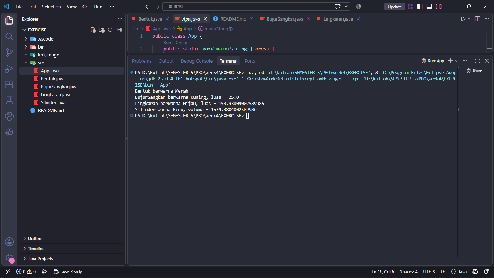

## Encapsulation

Program ini menerapkan konsep **Encapsulation** dengan membatasi akses langsung terhadap atribut pada setiap class.

Contohnya pada class `BujurSangkar`, atribut `sisi` dibuat menggunakan access modifier `private`:

```java
private double sisi;
```

Karena atribut `sisi` bersifat `private`, atribut tersebut tidak dapat diakses secara langsung dari luar class.

Untuk mengakses dan mengubah nilai `sisi`, digunakan method getter dan setter:

```java
public double getSisi() {
    return sisi;
}

public void setSisi(double sisi) {
    this.sisi = sisi;
}
```

Hal yang sama juga diterapkan pada atribut `radius` pada class `Lingkaran` dan atribut `tinggi` pada class `Silinder`.

### Alasan Menggunakan Encapsulation

Encapsulation digunakan agar data pada class tidak dapat diubah secara langsung dari luar class. Akses terhadap data dilakukan melalui method yang telah disediakan, yaitu getter dan setter.

Dengan demikian, data pada object dapat lebih terkontrol dan struktur program menjadi lebih terorganisir.


## Inheritance

Program ini menerapkan konsep **Inheritance** dengan menggunakan keyword `extends`.

Class `Bentuk` merupakan parent class dari `BujurSangkar` dan `Lingkaran`.

Sedangkan class `Silinder` merupakan turunan dari class `Lingkaran`.

Struktur hubungan inheritance dalam program:

```text
                    Bentuk
                   /      \
                  /        \
         BujurSangkar    Lingkaran
                              |
                              |
                           Silinder
```

Dalam struktur tersebut:

* `BujurSangkar` mewarisi atribut dan method dari `Bentuk`.

* `Lingkaran` mewarisi atribut dan method dari `Bentuk`.

* `Silinder` mewarisi atribut dan method dari `Lingkaran`.

* Karena `Silinder` merupakan turunan dari `Lingkaran`, maka `Silinder` juga dapat menggunakan atribut `warna` yang berasal dari class `Bentuk`.

Contoh penggunaan inheritance:

```java
public class BujurSangkar extends Bentuk
```

```java
public class Lingkaran extends Bentuk
```

```java
public class Silinder extends Lingkaran
```

Pada constructor class turunan juga digunakan `super()` untuk memanggil constructor dari parent class.

Contohnya pada class `Lingkaran`:

```java
public Lingkaran(double radius, String warna) {
    super(warna);
    this.radius = radius;
}
```

Sedangkan pada class `Silinder`:

```java
public Silinder(double tinggi, double radius, String warna) {
    super(radius, warna);
    this.tinggi = tinggi;
}
```


## Polymorphism

Program ini menerapkan konsep **Polymorphism** menggunakan method overriding.

Method `printInfo()` yang terdapat pada class `Bentuk` dioverride oleh class turunannya, sehingga setiap class dapat memiliki implementasi `printInfo()` yang berbeda.

Pada class `Bentuk`:

```java
public void printInfo() {
    System.out.println("Bentuk berwarna " + warna);
}
```

Pada class `BujurSangkar`:

```java
@Override
public void printInfo() {
    System.out.println("BujurSangkar berwarna " + warna + ", luas = " + hitungLuas());
}
```

Pada class `Lingkaran`:

```java
@Override
public void printInfo() {
    System.out.println("Lingkaran berwarna " + warna + ", luas = " + hitungLuas());
}
```

Pada class `Silinder`:

```java
@Override
public void printInfo() {
    System.out.println("Silinder warna " + warna + ", volume = " + hitungVolume());
}
```

Dengan adanya overriding, method dengan nama yang sama yaitu `printInfo()` dapat menghasilkan output yang berbeda sesuai dengan object yang digunakan.


## Contoh Penggunaan di Dalam Kode

```java
Bentuk bentuk = new Bentuk("Merah");
BujurSangkar bujurSangkar = new BujurSangkar(5, "Biru");
Lingkaran lingkaran = new Lingkaran(7, "Hijau");
Silinder silinder = new Silinder(10, 7, "Kuning");

bentuk.printInfo();
bujurSangkar.printInfo();
lingkaran.printInfo();
silinder.printInfo();
```

Program akan menjalankan `printInfo()` sesuai dengan masing-masing class.

Contoh hasil output:

```text
Bentuk berwarna Merah

BujurSangkar berwarna Biru, luas = 25.0

Lingkaran berwarna Hijau, luas = 153.93804002589985

Silinder warna Kuning, volume = 1539.3804002589986
```


## Contoh output:

